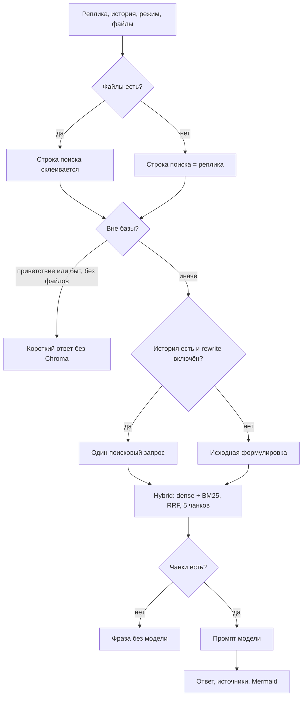

# Путь от реплики до ответа

Исходная реплика доходит до модели блоком «ВОПРОС». Ответ меняют фрагменты wiki в «КОНТЕКСТЕ» и несколько служебных блоков рядом.

По умолчанию включены переписывание при непустой истории, гибридный поиск, пропуск базы на приветствиях и автофикс Mermaid. Multi-query, HyDE, deep retrieval и rerank выключены.

## 1. Вход

Берутся реплика, история чата, режим (обычный, кратко, инструкция) и вложения. Текст файлов и описание скриншота склеиваются в строку поиска. Картинки пользователя уходят в модель, если чат идёт через OpenAI-совместимый API.

## 2. Вне базы

Вложений нет, и фраза — приветствие или бытовой вопрос (`RAG_CHITCHAT_SKIP_RETRIEVAL` включён): модель отвечает коротко, поиск по Chroma не открывается.

## 3. Переписывание

История не пуста и `CONVERSATIONAL_REWRITE_ENABLED` включён: отдельный вызов модели делает один самодостаточный запрос. Им ищут документы. В промпт он попадает строкой «ПОИСКОВЫЙ ЗАПРОС», когда отличается от реплики. История пуста: ищут исходную формулировку. Берутся последние 6 сообщений (`RAG_QUERY_EXPANSION_MAX_MESSAGES`).

Рядом выключены `RAG_MULTI_QUERY_ENABLED`, `RAG_HYDE_ENABLED` и `DEEP_RETRIEVAL_ENABLED`.

Если включить multi-query, модель запрашивает до `RAG_MULTI_QUERY_COUNT` дополнительных формулировок (1–4, по умолчанию 3). Ответ модели ограничивается этим количеством; исходный запрос сохраняется отдельно. Настройка доступна в «Админка → Пайплайн» и в общем каталоге настроек. Вкладки используют единый черновик и серверные runtime overrides.

## 4. Отбор чанков

Один проход, режим `hybrid`: вектор по строке поиска и BM25, слияние RRF, остаются 5 чанков (`RAG_TOP_K`). Порог score — 0 (`RAG_MIN_SCORE`); чат может прислать свои `top_k` и `min_score`. Rerank выключен.

Нет эмбеддинга — ответ не собирается. Чанков нет — фиксированная фраза, модель не вызывается.

В индексе чанки уже структурные, зачёркнутое помечено `[УСТАРЕЛО]`.

## 5. Ответ

Модель читает контекст (до 90 000 символов), историю, вопрос и режим. Картинки wiki из visual-чанков добавляются, пока включён `RAG_VISUAL_CONTEXT_ENABLED`. В потоке чата рассуждения модели срезаются. Если предложение из чанка дословно есть в ответе, в конец дописывается блок «Источники» (до 5). Блок Mermaid при наличии правится отдельным вызовом. В сообщение сохраняется переписанная строка поиска (`retrieval_query_text`).

## Что читает модель

| Блок | Когда попадает |
| --- | --- |
| `КОНТЕКСТ` | Тексты отобранных чанков |
| `ВОПРОС` | Всегда исходная реплика |
| `ИСТОРИЯ` | В чате есть сообщения |
| `ПОИСКОВЫЙ ЗАПРОС` | Строка поиска отличается от реплики |
| `ВЛОЖЕНИЯ` | Есть текст файла или описание картинки |
| Режим | Обычный, кратко или инструкция |
| Картинки wiki | Visual-чанк и vision-модель |
